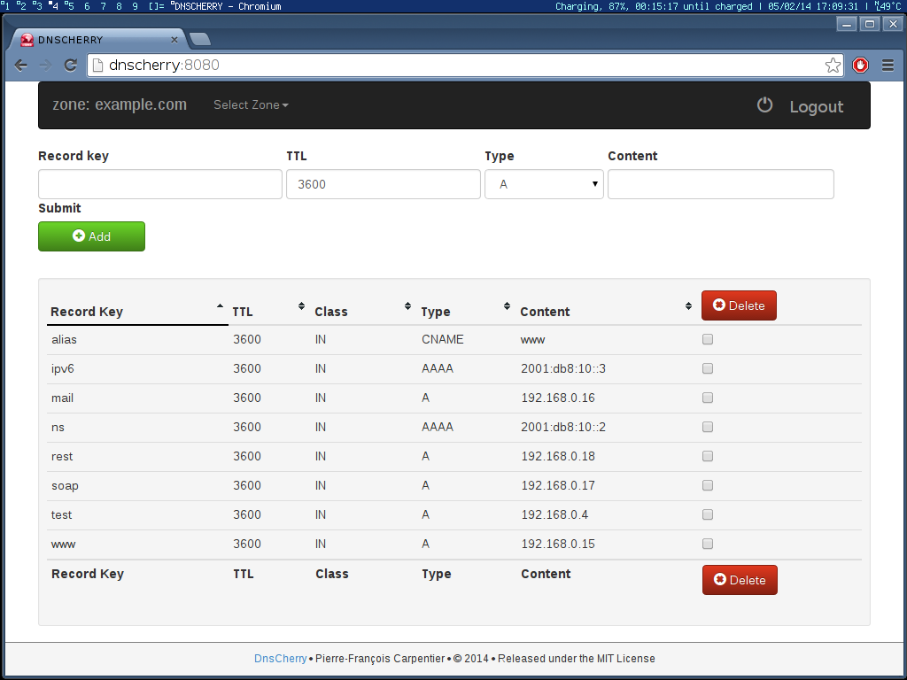

DnsCherry
=========

.. image:: https://github.com/kakwa/dnscherry/actions/workflows/tests.yml/badge.svg
    :target: https://github.com/kakwa/dnscherry/actions/workflows/tests.yml
    :alt: CI

.. image:: https://coveralls.io/repos/kakwa/dnscherry/badge.svg
    :target: https://coveralls.io/r/kakwa/dnscherry

.. image:: https://img.shields.io/pypi/v/dnscherry.svg
    :target: https://pypi.python.org/pypi/dnscherry
    :alt: PyPI version

.. image:: https://readthedocs.org/projects/dnscherry/badge/?version=latest
    :target: https://dnscherry.readthedocs.io/en/latest/?badge=latest
    :alt: Documentation Status

----

* **PyPI:** https://pypi.python.org/pypi/dnscherry
* **Documentation:** https://dnscherry.readthedocs.io/
* **License:** MIT
* **Author:** Pierre-Francois Carpentier (© 2014)

----

About
=====

**DnsCherry** is a small `CherryPy`_ web app to manage DNS zones. It adds and
removes records on one or more servers using `RFC 2136`_ dynamic updates and
TSIG (HMAC).

.. _CherryPy: https://cherrypy.dev/
.. _RFC 2136: https://datatracker.ietf.org/doc/html/rfc2136

Screenshot
==========

Installation
============

::

    pip install dnscherry

Prebuilt Debian/RPM packages: https://github.com/kakwa/kakwalab-pkg (package name ``dnscherry``).

Full install, DNS server setup, and deployment: see the `documentation`_.

.. _documentation: https://dnscherry.readthedocs.io/

License
=======

Released under the MIT license.
