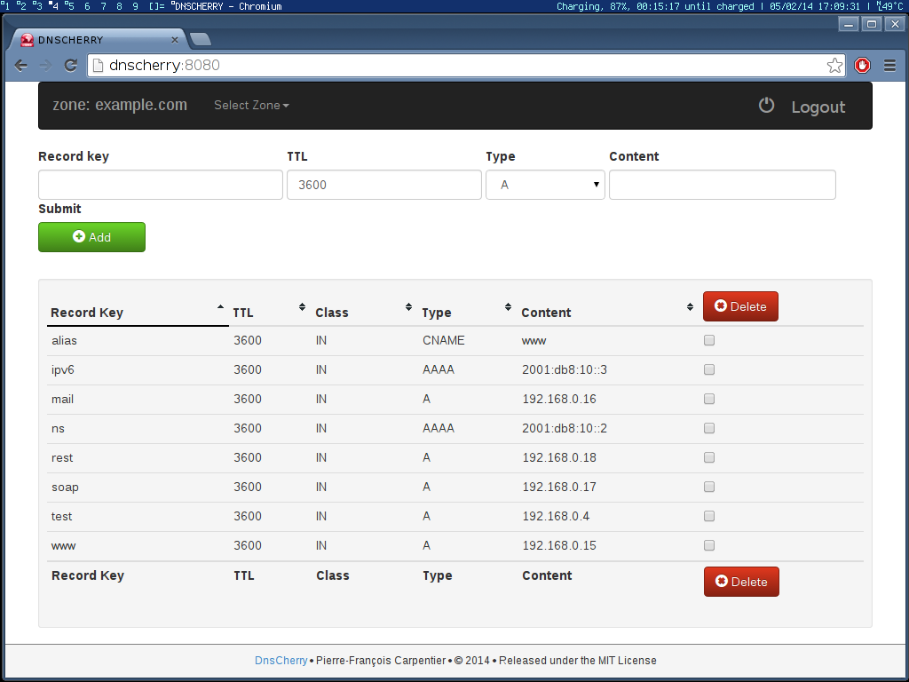

==============
  DnsCherry
==============

Web UI for DNS zone management.

----

| **Source:** https://github.com/kakwa/dnscherry
| **PyPI:** https://pypi.python.org/pypi/dnscherry
| **License:** MIT
| **Author:** Pierre-Francois Carpentier (© 2014)

----

*************
  Contents
*************

.. toctree::
    :maxdepth: 1

    install
    deploy
    auth_module
    changelog

****************
  Overview
****************

DnsCherry is a CherryPy application for editing DNS zones.

Features:

* Add or delete records in one or more zones (TSIG / dynamic update)
* Authentication via htpasswd, LDAP, HTTP headers (e.g. behind SSO), or custom modules
* Optional audit trail via access and application logs (file or syslog)

DnsCherry is intended to be simple to deploy and operate.

**************
  Screenshot
**************

*******************************
  Help and feedback
*******************************

* **Issues:** https://github.com/kakwa/dnscherry/issues

----

